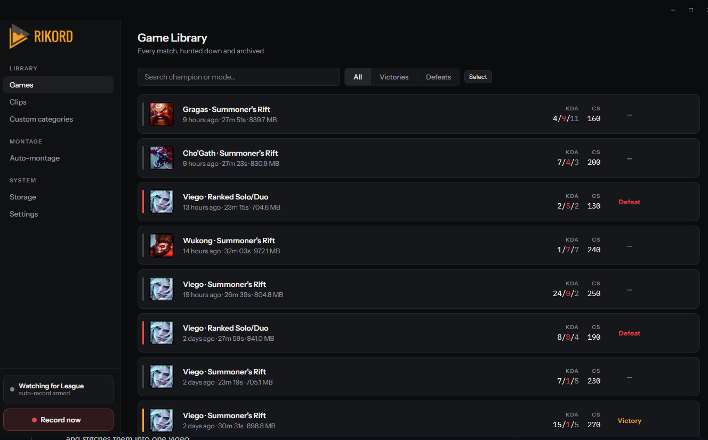

# Rikord

I play League. I got tired of finding out after the match that the best fight of the night was never recorded. So I built a recorder that does it without being asked.

Rikord starts when the game starts and stops when it ends, and every kill, death and assist lands on the timeline, so you scroll to a moment instead of hunting for it. Then it cuts the moments into a video.

## Download

### [Download the latest installer](https://github.com/Albidev1/rikord-releases/releases/latest)

Take `Rikord-Setup-<version>.exe` from Assets and run it. It needs Windows 10 or 11, 64-bit, and installs for your user only, so there is no admin prompt.

Windows will say "Windows protected your PC". The installer is not code-signed yet. Click More info, then Run anyway.

## What it does

- Records on its own. It watches for a League match and starts and stops with the game. There is a Record button for everything else.
- Marks the moments. Kills, deaths and assists sit on the timeline under the video. Click one and the clip range is already set around it.
- Cuts quick clips. Set a range and save it. If you recorded with your webcam on, you can cut the camera out and keep the bare game.
- Builds montages two ways. Auto montage takes your games, the moments you want and how many seconds before and after. Manual montage lets you pick clips and parts of games yourself, set the order and save a draft.
- Adds captions. They are made on your PC from your microphone track, in Polish or English. The speech models download when you click for them, not before.
- Keeps the sound apart. Mix, microphone and game audio land on three separate tracks. If your webcam runs behind your voice, Rikord can measure the delay from a clap and fix it.
- Brings its own ffmpeg and picks the encoder that fits your machine: NVIDIA, AMD, Intel or CPU.

Recordings land in `Videos\Rikord`. They stay on your PC unless you send them somewhere yourself.

## When the picture freezes

League in exclusive fullscreen can be hidden from every recorder by Windows. When that happens, Rikord puts a notice in the recording instead of a frozen frame, the sound keeps going, and a message after the match tells you how long it lasted. Settings > Help > Save report writes a file that shows why it happened on your machine. Attach it to an issue here and I will take a look.

## Updates

Rikord checks here for new versions. When one lands, the app shows Update available in the sidebar. One click downloads it, one more installs it. It never interrupts a recording.

---

This repository only carries the installers. Issues and ideas are welcome.
